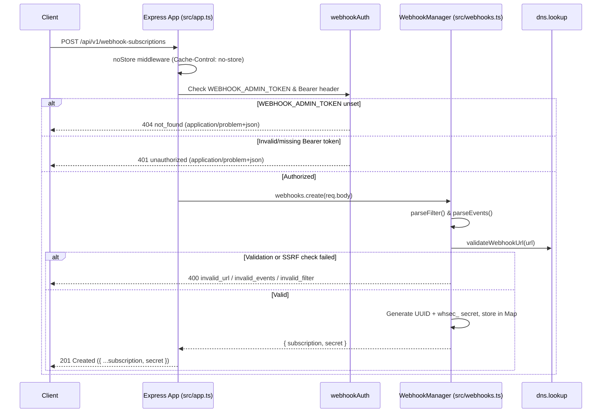
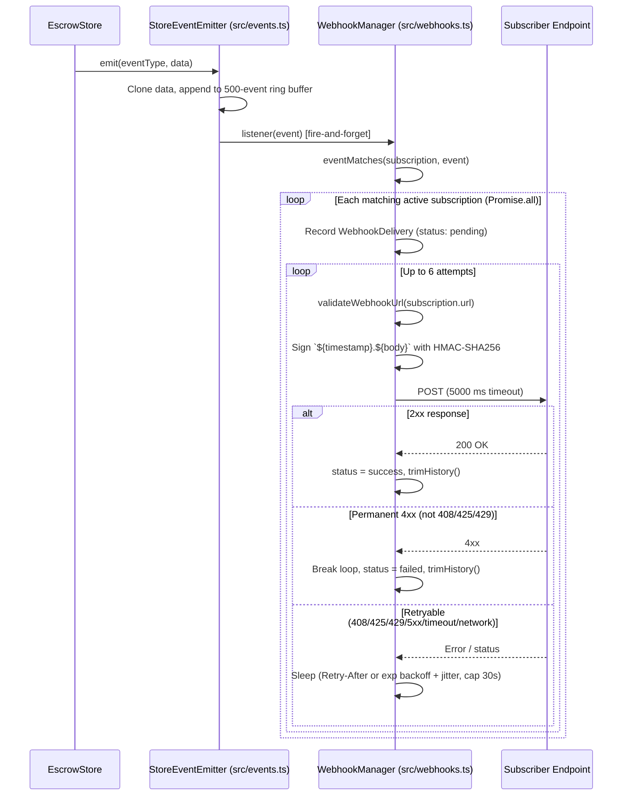

# Webhooks Request & Delivery Lifecycle

This document traces how webhook subscription requests and outbound event deliveries move through `src/app.ts`, `src/events.ts`, and `src/webhooks.ts`.

For endpoint schemas, headers, and error codes, see [Webhooks API Reference](webhooks.md).

## 1. Subscription Management Flow

All management routes are mounted at `/api/v1/webhook-subscriptions` in `src/app.ts`.

### Key Stages

1. **Cache protection (`src/app.ts`)**: `noStore` sets `Cache-Control: no-store` and `Pragma: no-cache` on all `/api/v1/webhook-subscriptions` responses.
2. **Admin auth (`src/app.ts` + `src/webhooks.ts`)**: `webhookAuth` fails closed with `404` when `WEBHOOK_ADMIN_TOKEN` is unset, and validates `Authorization: Bearer <token>` using `isWebhookAdminTokenValid`.
3. **Validation (`src/webhooks.ts`)**: `parseFilter`, `parseEvents`, and `validateWebhookUrl` (scheme, credentials, IPv4/IPv6 private-range check, and DNS resolution check) run before mutating state.
4. **In-memory storage (`src/webhooks.ts`)**: Subscriptions are stored in `WebhookManager.subscriptions` (`Map<string, WebhookSubscription>`). The `secret` is stripped by `publicSubscription` on `GET`/`PATCH` and returned only on `POST /` and `POST /:id/rotate-secret`.

## 2. Event Emission & Delivery Flow

When a store mutation occurs, `EscrowStore` emits an `EscrowEvent` via `StoreEventEmitter` (`src/events.ts`). `WebhookManager` registers a listener in its constructor (`events.on((event) => { void this.dispatch(event); })`).

### Key Stages

1. **Isolation (`src/events.ts`)**: `StoreEventEmitter.emit` wraps listener calls in `try/catch` so webhook failures never roll back a store mutation.
2. **Filtering (`src/webhooks.ts`)**: `eventMatches` checks `subscription.active`, event type membership (or `"*"`), and optional `filter.contractIds` / `filter.parties` against `event.data.contract`.
3. **Delivery & retries (`src/webhooks.ts`)**: `deliver` re-validates the URL on each attempt, signs the JSON payload, sends a `POST` with a `5000` ms timeout, and retries transient failures up to `6` times with exponential backoff (`1000` ms base, `30000` ms cap, ±10% jitter) or `Retry-After` (capped at `30000` ms).
4. **History trimming (`src/webhooks.ts`)**: `trimHistory` caps total retained deliveries at `1000` (`maxHistory`), evicting the oldest entries from both `deliveries` and `deliveriesBySubscription`.

## Related Documentation

- [Webhooks API Reference](webhooks.md)
- [Webhooks API Examples](webhooks-examples.md)
- [Webhooks Operations Runbook](runbook-webhooks.md)
